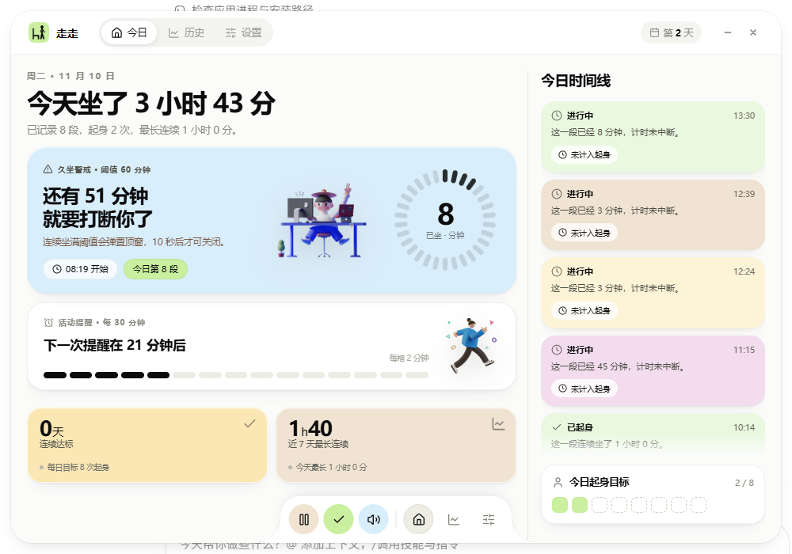
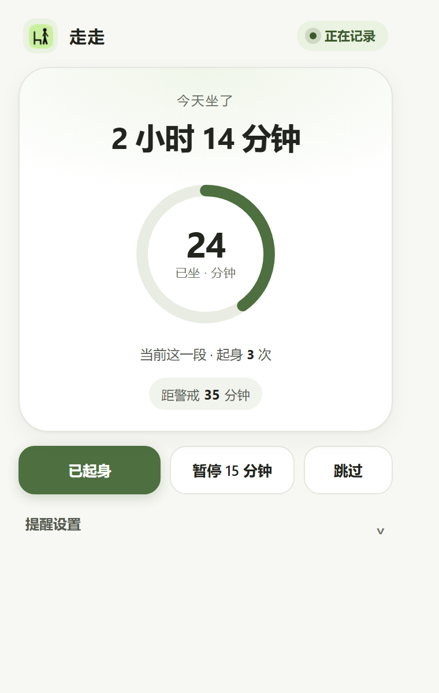

<div align="center">


# 走走 · 久坐提醒

坐久了提醒你站起来，并记录每天坐了多久。

**只在本机运行，不上传、不联网。**

[桌面端](#桌面端-windows) · [浏览器扩展](#浏览器扩展-chrome--edge) · [目录结构](#目录结构) · [开发](#开发) · [桌面端手册](docs/desktop-guide.md)

 

</div>

---

<div align="center">
  
  <sub>桌面端 · 今日页</sub>
</div>

## 这是什么

同一个产品的两种形态，共用一套视觉与计时口径，**数据互不相通**：

| | 桌面端 | 浏览器扩展 |
|---|---|---|
| 形态 | Windows 桌面应用（Tauri 2 + Rust） | Chrome / Edge 扩展（MV3） |
| 计时 | 1 秒一次，读系统级键鼠空闲 | 30 秒一次，读 `chrome.idle` |
| 提醒 | 30 分钟轻提醒 + 60 分钟置顶警戒窗 | 60 分钟警戒通知，工具栏徽标常驻倒计时 |
| 数据 | 本地 SQLite，保留历史 | `chrome.storage.local`，只存当天 |
| 适合 | 一整天在电脑前工作 | 主要在浏览器里工作，不想装软件 |

## 功能

**两端都有**

- 连续坐够阈值才提醒，起身或离座即清零，不会误报
- 「已起身 / 暂停 15 分钟 / 跳过」三个动作，通知上直接可点
- 离座判定：键鼠空闲超过设定分钟数即视为离座，计时暂停
- 工作日掩码：不选的日子不提醒，但时长照记
- 今日累计、当前这一段、起身次数
- 提示音开关；数据只写本机

**只有桌面端**

- 双轴提醒：轻提醒（右上角卡片，9 秒消失）与警戒（右下角置顶窗，10 秒倒计时锁「已起身」，未响应 5 分钟重申）
- 历史页：日均、达标天数、环比、时段分布热力图、逐日明细
- 系统托盘、开机自启、CSV 导出、界面中英文、主题色

## 安装

### 桌面端（Windows）

到 Releases 下载 `走走_0.1.0_x64-setup.exe` 安装。安装包未做代码签名，首次运行会提示「未知发布者」。

> 数据在 `%APPDATA%\app.sitless.desktop\sitless.db`，卸载不会删除。详细用法见 [桌面端手册](docs/desktop-guide.md)。

### 浏览器扩展（Chrome / Edge）

<div align="center">
  
  <br>
  <sub>点工具栏图标打开的 popup</sub>
</div>

到 Releases 下载 `sitless-extension.zip`，解压后：

1. 打开 `chrome://extensions`（Edge 为 `edge://extensions`）
2. 打开右上角「开发者模式」
3. 点「加载已解压的扩展程序」，选择解压出的目录

> 需要 Chrome 120+。也可以自行构建后加载 `extension/dist`，见下文。

## 目录结构

```
久坐提醒/
├─ app/                    桌面端（Tauri 2 + React + Rust）
│  ├─ src/                 前端：今日 / 历史 / 设置三页，提醒窗
│  ├─ src-tauri/src/       Rust：状态机、计时、SQLite、提醒窗、托盘
│  ├─ src-tauri/icons/     桌面图标（由 design/logo 生成，勿手改）
│  ├─ public/              运行时静态资源：logo、3D 插画、日历图
│  └─ scripts/             全量校验 verify.py、音效生成、CSS 类名检查
│
├─ extension/              浏览器扩展（MV3 + React）
│  ├─ src/sw.ts            service worker：计时、提醒、徽标
│  ├─ src/popup.tsx        popup 界面
│  ├─ public/              manifest.json + 图标（由 design/logo 生成）
│  ├─ scripts/             逻辑断言 verify.mjs、打包 zip.mjs
│  └─ dist/                构建产物，不入库（pnpm build 生成）
│
├─ design/                 设计资源
│  ├─ logo/                图标唯一源头：mark.svg + 生成脚本，见其中的 README
│  ├─ screenshots/         成品截图（README 用两张，其余备用）
│  ├─ assets/              3D 插画源文件
│  ├─ source/              第三方素材包与原始压缩包，不入库
│  └─ prototype.html       早期静态原型
│
├─ docs/                   桌面端完整手册
└─ README.md
```

## 静态资源怎么管

**图标只有一份源头**：`design/logo/mark.svg`。桌面端、扩展、macOS/iOS/Android 的图标全部由脚本导出，任何一处产物都不要手改：

```bash
python design/logo/make_logo.py             # 改造型时：坐标 → mark.svg
python design/logo/rasterize.py             # mark.svg → mark.png（调本机 Edge/Chrome）
python design/logo/export_icons.py          # → 前端 logo + Windows 图标 + 扩展图标
python design/logo/export_platform_icons.py # → icns / ios / android
```

其余资源：

| 目录 | 内容 | 是否入库 |
|---|---|---|
| `design/screenshots/` | 成品截图：桌面三页 + 扩展四态 | 是 |
| `design/assets/` | 界面里用到的 3D 插画 | 是 |
| `design/source/` | 第三方素材包、原始 zip | 否（体积大） |
| `app/public/art/` | 桌面端运行时读取的插画副本 | 是 |

## 开发

### 桌面端

需要 Node 20+、pnpm、Rust 工具链、Windows 上的 WebView2。

```bash
cd app
pnpm install
pnpm tauri dev        # 真实桌面应用（需要 Rust）
pnpm dev              # 只跑前端，浏览器里看界面
pnpm verify           # 前端构建 + oxlint + CSS 类名 + i18n 词条 + cargo test
```

打包：`pnpm tauri build`，产物在 `app/src-tauri/target/release/bundle/`。

### 浏览器扩展

```bash
cd extension
pnpm install
pnpm dev              # Vite 热更新（popup 部分）
pnpm verify           # tsc --noEmit + 构建 + 打 zip
pnpm test             # 构建 + 在 mock 的 Chrome API 上跑逻辑断言
```

产物：`extension/dist/`（可直接加载）与 `extension/sitless-extension.zip`。

## 计时规则

两端共用一套口径，改统计前先读这一节。

- **段**：从坐下到起身算一段。中途离座、已起身、暂停恢复都会切段
- **起身次数**只认真正站起来：离座、点「已起身」计入；跨零点、退出应用只结算不加
- **取整**一律向下取整，只数坐满的整分钟
- **跨零点**拆成两段，分别归到两天
- **断点续接**：重启间隔 ≤ `max(离座阈值, 5 分钟)` 时续接同一段，间隔不计入
- **扩展限制**：Chrome 完全退出期间不运行，既不计时也不提醒，且只存当天

## 数据与隐私

- 桌面端：SQLite 位于 `%APPDATA%\app.sitless.desktop\sitless.db`，日志在 `%LOCALAPPDATA%\app.sitless.desktop\logs\`
- 扩展：`chrome.storage.local`，权限只有 `alarms` / `storage` / `idle` / `notifications`，**没有 host 权限**
- 两端都不发起网络请求，不收集、不上报

## 已知限制

- 桌面端只打包 Windows；macOS / Linux 需要补系统级空闲检测、全屏判定与签名公证
- 扩展在 Chrome 完全退出后不计时，也没有历史统计
- 扩展无法判断系统级全屏（会议、视频），因此不做「全屏时抑制提醒」

## License

[MIT](LICENSE)
